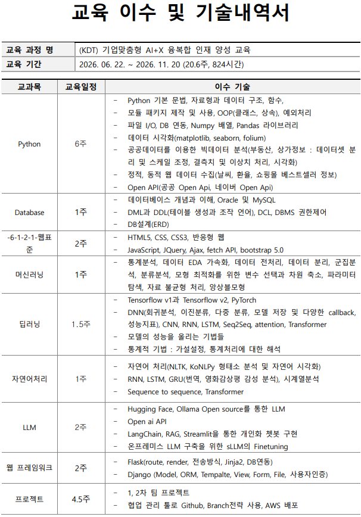

# AI 학습 기록

KDT AI-X 교육과정에서 학습한 Python, 웹 개발, 데이터베이스와 AI 실습을 모았습니다.
수업 자료와 개인 실습을 함께 보관하며, 실제 프로젝트 적용 자료는 별도 프로젝트 저장소에서 확인할 수 있습니다.

[포트폴리오 홈페이지](https://ai-mbc.github.io/) · [GitHub 프로필](https://github.com/ai-mbc) · [1차 프로젝트 · 노른자추적](https://github.com/ai-mbc/1stProject)

## 교육과정 · AI+X 융복합 인재 양성

**(KDT) 기업맞춤형 AI+X 융복합 인재 양성 교육**

| 교육 기간 | 전체 교육량 | 현재 상태 |
| --- | --- | --- |
| 2026.06.22 ~ 2026.11.20 | 20.6주 · 824시간 | 교육 진행 중 · 수료 예정 2026.11.20 |

학원의 교육 계획에 따라 학습을 진행하고 있습니다. 실제 학습·구현 내용은 실습 코드와 프로젝트에서 확인할 수 있습니다.

| 교육 영역 | 계획 기간 | 주요 학습 내용 |
| --- | --- | --- |
| Python | 6주 | 문법·자료구조·함수·OOP, 파일 I/O, NumPy·Pandas, 시각화, 공공데이터 분석·수집, Open API |
| 데이터베이스 | 1주 | Oracle·MySQL, DML·DDL·DCL, DBMS 권한 제어, ERD 설계 |
| 웹 표준 | 2주 | HTML5·CSS·반응형 웹, JavaScript·jQuery·Ajax·fetch API, Bootstrap 5 |
| 머신러닝 | 1주 | 통계·EDA, 전처리·데이터 분리, 회귀·분류·군집, 변수 선택·차원 축소, 최적화·불균형 처리·앙상블 |
| 딥러닝 | 1.5주 | TensorFlow·PyTorch, DNN·CNN·RNN·LSTM, Seq2Seq·Attention·Transformer, 모델 저장·콜백, 가설 검정 |
| 자연어처리 | 1주 | NLTK·KoNLPy, 형태소 분석·시각화, RNN·LSTM·GRU, 번역·감성 분석·시계열, Seq2Seq·Transformer |
| LLM | 2주 | Hugging Face·Ollama, OpenAI API, LangChain·RAG·Streamlit, 개인화 챗봇, sLLM 파인튜닝 |
| 웹 프레임워크 | 2주 | Flask 라우팅·렌더링·Jinja2·DB 연동, Django Model·ORM·Template·View·Form·File·인증 |
| 프로젝트 | 4.5주 | 1·2차 팀 프로젝트, GitHub 협업·브랜치 전략, AWS 배포 |

※ 전체 교육량과 과목별 기간은 교육기관에서 제공한 원본 일정표 기준입니다.

원본 교육 이수 및 기술내역서 보기

## 주제별 실습

| 주제 | 실습 폴더 |
| --- | --- |
| Python | [source/01_python](source/01_python/) |
| HTML·CSS | [source/02_HTML-CSS](source/02_HTML-CSS/) |
| JavaScript | [source/03_javaScript](source/03_javaScript/) |
| 데이터베이스 | [source/04_DBMS](source/04_DBMS/) |
| 딥러닝 | [source/05_DeepLearning](source/05_DeepLearning/) |
| 자연어처리 | [source/06_자연어처리](source/06_자연어처리/) |
| LLM | [source/07_LLM](source/07_LLM/) |
| 머신러닝 | [source/08_MachineLearning](source/08_MachineLearning/) |
| Flask | [source/10_flask](source/10_flask/) |

## 자료 구성

- [lecNote](lecNote/) — Python, HTML·CSS, JavaScript, DBMS 강의 자료
- [note](note/) — 학습 노트
- [source](source/) — 주제별 코드와 노트북 실습
- [typesafe-kiri-demo](typesafe-kiri-demo/) — TypeSafe 관련 실험 자료

## 보는 방법

관심 있는 주제의 폴더에서 코드와 노트북을 확인하세요. 실습마다 사용하는 패키지·데이터·환경이 다를 수 있으므로 실행 전 해당 파일의 설명과 경로를 확인해야 합니다.

## 앞으로의 기록 방식

대표 실습을 정리할 때는 학습 목표, 배운 점, 막힌 점과 해결 방법, 프로젝트에 적용한 내용을 함께 기록합니다. 수업 예제와 직접 수정한 부분을 구분해 학습 과정을 보여줄 계획입니다.
